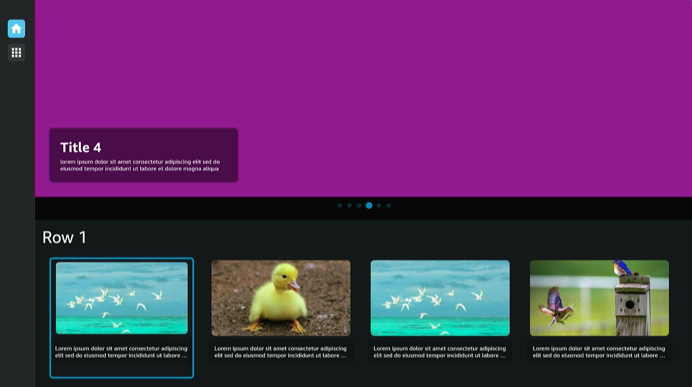

Vega TV Interfaces Sample App
=============================

The Vega TV Interfaces Sample App is built with the Vega Developer Tools. This sample app demonstrates the recommended approaches for building TV-focused interfaces with React Native.  



Introduction
------------

The TV Interfaces Example demonstrates how to build performant and user-friendly TV applications. This feature-focused sample app serves as a practical guide for developers implementing TV-optimized layouts and components.

Key features include:

* How to structure different TV interfaces:
  * Home page layout with hero sections and horizontal carousels.
  * Drawer navigation for additional sections.
  * Vertical stack layouts for content organization.
* Recommended approaches for component design in TV applications.
* Why certain patterns work better for remote based navigation.
* Practical examples of focus management in complex layouts.


**Note**: While this app contains recommendations, there will always be different approaches on how to build the components or screen or libraries used (FlashList). This guide is a starting point for what needs to be done, but we encourage you to explore and adopt best practices that suit your specific project requirements but always [think in React](https://react.dev/learn/thinking-in-react).
          
          
### Why TV interfaces are different
          
TV applications are navigated primarily with directional controls (up, down, left, right) rather than touch. This fundamentally changes how users interact with your app:
          
 * Users can only interact with one element at a time (the focused element).
 * Navigation paths between elements must be clear and predictable.
 * Visual feedback for focus states is critical.
 * Performance considerations are different on TV hardware.
          
The examples in this document demonstrate proven patterns that create intuitive, responsive TV experiences using the Vega Developer Tools.

Documentation Overview
----------------------

This sample app's documentation is organized into the following sections:

In this README:
* Build and Run Instructions
* Troubleshooting
* Testing Setup
* API and Services Architecture
* UI Customization
* Translations Setup

Detailed Component and Hook Documentation:
* [Components](./docs/components.md) - Detailed documentation of TV-optimized components including Grid, Box, Modal, and Drawer systems.
* [Hooks](./docs/hooks.md) - Collection of custom hooks for TV interface development.


Build and run the app
---------------------

### Prerequisites

Before you launch the sample app, make sure that you have [installed the Vega Developer Tools](https://developer.amazon.com/docs/vega/latest/install-vega-sdk.html) and NodeJS 18-20.


### Step 1: Build the app

After you download the source code from GitHub, you can build the Vega TV Interfaces Sample App from the command line to generate VPKG files. The VPKG files run on the Vega Virtual Device and Vega OS Fire TV Stick.

You can also use [Vega Studio](https://developer.amazon.com/docs/vega/latest/setup-extension.html#learn-the-basic-features) with Visual Studio Code to build the app.

1. At the command prompt, navigate to the Vega TV Interfaces Sample App source code directory. 

2. To install the app dependencies, run the following command. 

   ```
   npm install
   ```

3. To build the app to generate .vpkg files, run the following command.

   ```
   npm run build:app
   ```

4. At the command prompt, in the **build** folder, verify that you generated the VPKG files for your device's architecture.

   * **armv7-release/keplertvinterfaces_armv7.vpkg**&mdash;generated on x86_64 and Mac-M series devices to run on the Vega OS Fire TV Stick.
   * **x86_64-release/keplertvinterfaces_x86_64.vpkg**&mdash;generated on x86_64 device to run on the VVD.
   * **aarch64-release/keplertvinterfaces_aarch64.vpkg**&mdash;generated on Mac M-series device to run on the VVD.
   
### Step 2: Run the app

#### Vega Virtual Device

1. To start the Vega Virtual Device, at the command prompt, run the following command.

   ```
   vega virtual-device start
   ```

2. Go to the directory where you placed the VPKG files. 

3. To install and launch the app on the Vega Virtual Device, run the following command, depending on your device architecture.

   - On Mac M-series based devices. 
      
      ```
      vega run-app build/aarch64-release/keplertvinterfaces_aarch64.vpkg
      ```

   - On x86_64 based devices.
      
     ```
     vega run-app build/x86_64-release/keplertvinterfaces_x86_64.vpkg
     ```  

#### Vega OS Fire TV Stick

1. Turn on your Vega OS Fire TV Stick.

2. To install and launch the app on your Vega OS Fire TV Stick, run the following command.

   ```
   vega run-app build/armv7-release/keplertvinterfaces_armv7.vpkg
   ```


Troubleshooting the app
-----------------------

If you're facing unexpected issues while trying to build and run the app (For example, the build is failing randomly, the app is not starting, or the app is crashing randomly.) try the following solutions:

* Run the `npm run clean` command. This removes the `node_modules` folder and other files related to your previous builds.

* When working in debug mode, you might need to use `npm run start -- --reset-cache` to clear the cache.

* In some cases (changes done to patches, changes in package.json, etc.) you may need to make sure there is no cache present in the project, in order to build successfully. Cleaning ALL cache files in the project can be done by running the following commands:

```
npm run clean
npm cache clean --force
watchman watch-del-all
rm -fr $TMPDIR/haste-map-*
rm -rf $TMPDIR/metro-cache

npm install
npm start -- --reset-cache
```

* Restart the simulator. We have observed the simulator crashing randomly if it's used without restarting for extended periods of time.

* Run the `vega clean` command. This removes the artifacts generated in the top level `/.build` folder. To learn more, see the [Vega CLI Functions](https://developer.amazon.com/docs/vega/latest/cli-tools.html) document.


Testing the app
---------------

[React Native Testing Library (RNTL)](https://callstack.github.io/react-native-testing-library/) is used for component and integration testing in this project. RNTL provides a robust set of tools for testing React Native apps with a focus on user interactions and accessibility.

### React Native Testing Library (RNTL)

RNTL allows us to write tests that closely resemble how users interact with our app. It provides utilities for rendering components, finding elements, and simulating user actions.

### Test Commands

To run the test suite, use the following commands:

```
npm test
```

Run tests in watch mode:

```
npm run test:watch
```

For more detailed information about our testing setup, best practices, and custom utilities, please refer to the [testing documentation](./src/test-utils/README.md) in the test-utils directory.

Services
--------

The app is structured to delegate specific tasks to encapsulated units of logic known as services. Each service is designed to handle a particular functionality, allowing for clean separation of concerns and ensuring that the logic is reusable and maintainable. This approach allows services to be potentially extracted and used in other applications with ease.

- [**AppConfig Service**](src/services/appConfig/README.md): Manages environment variables defined in the `.env` file, enabling the app to read and apply configuration settings.

- [**DeviceInfo Service**](src/services/deviceInfo/README.md): Provides access to device-specific information, such as determining the type of device, and interacts with device-related APIs.

- [**DeviceStorage Service**](src/services/Storage/README.md): Provides access to device storage, by abstracting storage-related APIs exposed by `AsyncStorage`.

- [**NetInfo Service**](src/services/netInfo/README.md): Monitors internet connectivity, manages the network state, and listens for network-related events.

- [**i18n Service**](src/services/i18n/README.md): Provides methods to manage translations in the app.

- [**Focus Guide Service**](src/services/focusGuide/README.md): Provides hooks and wrappers to manage focusing elements in the app.

- [**Accessibility (a11y) Service**](src/services/a11y/README.md): Provides common logic for applying complex accessibility properties to components.

Customize the UI theme
----------------------

You can customize the UI by changing the color scheme and font settings. 

### Set up color 

**To customize the color theme**

1. Open any color scheme generator for Material Design, for example, https://material-foundation.github.io/material-theme-builder/ and create color scheme that you prefer.

2. Export created theme as a JSON file.

3. Go to the **palette.ts** (../../src/theme/palette.ts) file and replace the `lightPalette` and `darkPalette` objects to the generated.

4. Add additional custom colors.

   * `transparent` - definition of transparent color to avoid usage of. 
   * `focusPrimary` - colors used for highlight focused element.
   * `gradientPrimary` - definition of gradient color displayed as a background.
       
    Example:


   ```js
   transparent: 'transparent',
   focusPrimary: '#FDE8C7',
   gradientPrimary: ['rgba(255, 255, 255, 0)', 'rgba(255, 255, 255, 0.8)'],
   ```
  

5. Reload the app to view your changes.

### Set up the components UI

**To customize font sizes, colors, spaces for particular components**

1. Go to the **tokens** (../../src/theme/tokens) directory.
2. Edit any values to suit your needs.
3. Reload your app to view your changes.


### Detailed theming information

As a part of the Navigation Interface Focus Examples app, the `kepler-ui-components` library is used for the UI layer. All files related to the configuration of the theme should be kept in the **src/theme** directory.

**The src/theme/ directory structure:**


```
src/theme/
   |–– theme.ts - objects with themes, light and dark variant.
   |–– palette.ts - object with colors for dark and light variant.
   |–– tokens - directory that includes custom token objects.
   |–– [token_name].theme.ts - object with tokens for specific component
   |–– useAppTheme.ts - hook for getting tokens for current theme with custom typing.

```


### Create tokens for components

**To modify pre-defined tokens and follow defined palette**

1. Create a new file using the following format.

   **[token_name].theme.ts** pattern.
   
   Example: **badge.theme.ts**

2. Add custom tokens for a dark and light theme. 

   Example: 

   ```
   export const badgeTokensLight: Partial<BadgeTokens> = {
   container: {
      color: {
         borderColor: 'transparent',
         backgroundColor: lightPalette.background,
      },
   },
   label: {
      color: {
         textColor: lightPalette.onBackground',
      },
   },
   };

   export const badgeTokensLight: Partial<BadgeTokens> = {
   container: {
      color: {
         borderColor: 'transparent',
         backgroundColor: darkPalette.background,
      },
   },
   label: {
      color: {
         textColor: darkPalette.onBackground',
      },
   },
   };
   ```

  

3. Add new tokens to existing themes.

   Example: 

   ```
   export const lightTheme = createThemeFromPartialTheme<AppTheme>({
   //...
   badge: badgeTokensLight,
   });

   export const darkTheme = createThemeFromPartialTheme<AppTheme>({
   //...
   badge: badgeTokensDark,
   });
   ```

  

New tokens are visible after you reload your app.

Components
----------

To provide default props and customize components, importing directly from `@amazon-devices/kepler-ui-components` is blocked across the app.

Every component from UI library should have a created abstraction in the `src/components/core` directory. Please use components from `@AppComponents/core` or create a new one if it doesn't exist.


```jsx
import { Button } from '@AppComponents/core';
```


Do not use the following:


```jsx
import { Button } from '@amazon-devices/kepler-ui-components';
```


## Hooks


#### `useAppTheme`

The `useAppTheme` hook is a custom hook built on top of the `useTheme` hook from the `@amazon-devices/kepler-ui-components` package. It provides an easy way to access the the colors of the current theme, and typography from the theme of your application, which conforms to the `AppTheme` type.

##### Usage


```jsx
import { useAppTheme } from '@AppTheme';

const { isDarkTheme, colors, typography } = useAppTheme();
```


#### Returns

* **`isDarkTheme: boolean`**: Indicates whether the current theme is a dark theme by checking the theme `type` of the metadata.
* **`colors: object`**: Contains the color palette defined in the theme.
* **`typography: object`**: Contains the typography settings such as typeface, type sizes, and other related properties.

#### Dependencies

* **`useTheme<AppTheme>()`**: A hook from the `@amazon-devices/kepler-ui-components` library, with the `AppTheme` type passed in to define the theme structure.


#### `useThemedStyles`

The `useThemedStyles` hook allows you to generate dynamic styles in the component theme. It leverages the `useAppTheme` hook to get the current theme and applies a callback function to generate a `NamedStyles` object.

#### Usage


```typescript
import { useThemedStyles, AppTheme } from '@AppTheme';

const styles = useThemedStyles(({colors}: AppTheme) => StyleSheet.create({
  container: {
    backgroundColor: colors.background,
    color: colors.onBackground,
  },
}));
```


#### Parameters

* **`callback: (theme: AppTheme) => NamedStyles<T>`**: A function that takes the current theme and returns a `NamedStyles` object. This function can be used to generate styles that react to theme changes.

#### Returns

* **`NamedStyles<T>`**: A React Native `StyleSheet.NamedStyles` object generated using the provided callback function.

##### Dependencies

* **`useAppTheme()`**: A custom hook that provides the colors of the current themes and typography.
* **`StyleSheet.NamedStyles`**: A type from React Native's `StyleSheet` API for defining strongly-typed styles.


Set up translations
-------------------

This section describes how to adjust existing translations to your needs and includes detailed information about the i18n service.

### Language list

All available languages are defined in the **languages.ts** file (../../src/services/i18n/languages.ts).

```js
export const languages = [
  { key: 'en-US', label: 'english' },
  { key: 'es', label: 'spanish' },
] as const;
```


All items must correspond with directories in the **assets/text** directory.

### Change existing translations

All translations are located in **assets/text** directory using the following structure.


```
assets
└── text
├── en-US
│   └── strings.puff.json
├── pl
│   └── strings.puff.json
└── es
    └── strings.puff.json
```


To change translations, you must change all needed values in the translation files.

### Add new translations

1. Open the **assets/en-US/strings.puff.json** file as a default language file.

2. Add the needed translations.

3. To copy created keys to other translation files, run the following command.

   ```
   npm run i18n:sync 
   ```

4. Adjust values of the new keys to a specific language.


### i18n Service details

The i18n Service details section provides a React Native context and custom hook for internationalization (i18n) in the Navigation Interface Focus Examples app. This allows for setting and retrieving the current locale and provides a translation function to fetch and format localized messages.

#### Structure

Th Navigation Interface Focus Examples app uses the`PUFF-J` files as resources for translation. All files should be created in the **assets/text** directory. New translations should be added in directory with name of language code, for example, **assets/text/es/strings.puff.json**.>

```
assets
└── text
    ├── en-US
    │   └── strings.puff.json
    ├── pl
    │   └── strings.puff.json
    └── es
        └── strings.puff.json
```


Example JSON file:

```json
{
  "dir" : "ltr",
  "resources": {
    "test-id": {
      "note": "message for greeting",
      "value": "Howdy {username}!"
    },
    "login-title": "Log In",
    "login-password-label": "Password",
    "login-email-label": "Email",
    "login-button": "Log In"
  }
}
```


All changes in the files and new files are available after you rebuild your app using the following command. 

```
npm run build:app
```

#### Methods

##### `useTranslation`

The `useTranslation` hook returns an object containing the following methods:

* **`t(translationId: string, params?: { [key: string]: TranslationParamValue })`** 

  Fetches the translation for the given `translationId` based on the current locale. This method accepts an optional `params` object that provides dynamic values to inject into the translation string. If the translation can't be found or fails, the `translationId` is returned as a fallback.

* **`locale`**  

  The current locale, for example, `en-US`. This is the language and region format used to resolve translations.

* **`setLocale(locale: string)`**  

  A method to change the current locale. When called, it updates the locale across the application.

##### `TranslationProvider` component

The `TranslationProvider` component is a context provider that wraps your app to supply localization features. It allows for managing the current locale and provides a mechanism to update it across your app.

#### `TranslationProviderProps`

* **`children: ReactNode`** 

  The child components that are wrapped by the `TranslationProvider`, and have access to the translation context.

* **`defaultLocale?: Languages`**  

  (Optional) The default locale to be set when the provider initializes. If not provided, the default locale is set to `'en-US'`.

#### Usage

```tsx
import React from 'react';
import { TranslationProvider } from '@AppServices/i18n';

const App = () => (
  <TranslationProvider defaultLocale="pl">
    {/* Other components */}
  </TranslationProvider>
);
```

#### Syncing translation files

To keep all translation files with the same shape, we provide a script to sync the files automatically. After adding default translations (en-US), to generate the same keys for other languages and provide proper values, run the following command.

```
npm run i18n:sync
```
Release Notes
-------------

- v0.21

  Initial release.

License
-------

This project is licensed under the MIT-0 License - see the [LICENSE](LICENSE) file for details.

This project uses images from [Pexel](https://www.pexels.com/license/).